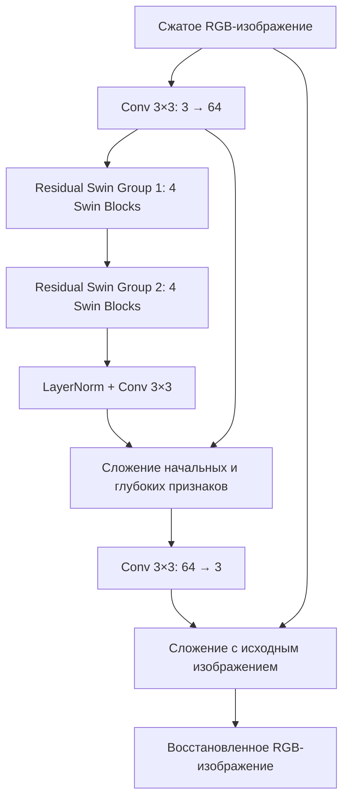
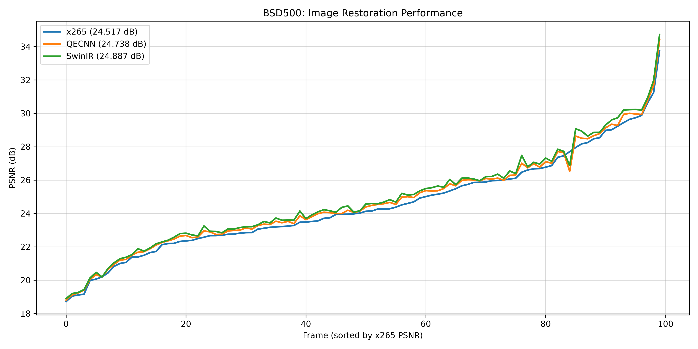

# Лабораторная работа по теории информации

## Восстановление изображений после сжатия H.265 с помощью SwinIR

**Выполнил:** Вишнивецкий Даниил  
**Группа:** указать номер группы  
**Университет:** Университет ИТМО

## 1. Постановка задачи

Цель работы — улучшить качество изображений после сжатия и декодирования кодеком H.265 (x265) с помощью нейронной сети. В качестве базовой модели используется предоставленная свёрточная нейронная сеть QECNN.

Для обучения используются предоставленные изображения BSD500 в формате YUV420 с разрешением 480×320. Согласно описанию исходного проекта, сжатие выполнялось кодеком x265 при QP = 35.

Пусть $X_i$ — декодированное изображение после сжатия, $Y_i$ — соответствующее исходное изображение, а $f_\theta$ — модель восстановления с обучаемыми параметрами $\theta$. Значения RGB нормализуются в диапазон $[0,1]$.

$$
X_i,Y_i\in\mathbb R^{H\times W\times 3},\qquad H=320,\quad W=480.
$$

Необходимо найти такое преобразование, при котором восстановленное изображение $\widehat Y_i=f_\theta(X_i)$ максимально близко к оригиналу. Используется остаточное обучение:

$$
\widehat Y_i=X_i+g_\theta(X_i),
$$

где $g_\theta$ предсказывает поправку к декодированному изображению. При оценке выход модели ограничивается диапазоном $[0,1]$.

Функция потерь — среднеквадратичная ошибка (MSE). Для батча из $N$ пар обучающих патчей размером $H_p\times W_p$:

$$
\mathcal L(\theta)=\frac{1}{3NH_pW_p}\sum_{i=1}^{N}\sum_{h=1}^{H_p}\sum_{w=1}^{W_p}\sum_{c=1}^{3}\left(Y_{i,h,w,c}-f_\theta(X_i)_{h,w,c}\right)^2.
$$

Качество оценивается по PSNR на целых изображениях:

$$
\operatorname{MSE}_i=\frac{1}{3HW}\sum_{h=1}^{H}\sum_{w=1}^{W}\sum_{c=1}^{3}(Y_{i,h,w,c}-\widehat Y_{i,h,w,c})^2,
$$

$$
\operatorname{PSNR}_i=10\log_{10}\frac{1}{\operatorname{MSE}_i+10^{-10}}.
$$

Средний PSNR вычисляется как арифметическое среднее значений по 100 тестовым изображениям:

$$
\overline{\operatorname{PSNR}}=\frac{1}{100}\sum_{i=1}^{100}\operatorname{PSNR}_i.
$$

Выигрыш относительно базовой модели:

$$
\Delta_{\mathrm{QECNN}}=\overline{\operatorname{PSNR}}_{\mathrm{SwinIR}}-\overline{\operatorname{PSNR}}_{\mathrm{QECNN}}.
$$

По условию лабораторной работы необходимо обеспечить выигрыш не менее 0,1 дБ относительно QECNN, или около 0,32 дБ относительно декодера H.265. Обучение предложенной модели выполняется с нуля на предоставленных обучающих изображениях, без использования внешних предобученных весов.

## 2. Структура репозитория и инструкция по запуску

Репозиторий: [Laboratory_Vishnivetsky_information_theory](https://github.com/Daniil-Vishnivetskii/Laboratory_Vishnivetsky_information_theory).

| Объект | Назначение |
| --- | --- |
| `enhancer.py` | Реализация предложенной модели SwinIR, подготовка данных, обучение и тестирование. |
| `support.py` | Вспомогательные функции чтения YUV, преобразования в RGB, расчёта PSNR и визуализации. |
| `qecnn.py` | Исходная реализация базовой модели QECNN для сравнения. |
| `best_swinir.pth` | Веса предложенной модели, сохранённые по максимальному среднему PSNR на валидационной выборке. |
| `best_model2026.pth` | Предоставленные веса базовой QECNN; используются только для сравнительной оценки. |
| `trainrawyuv/` | Исходные обучающие изображения. |
| `traincompyuv/` | Соответствующие изображения после сжатия H.265. |
| `testrawyuv/` | Исходные тестовые изображения. |
| `testcompyuv/` | Соответствующие тестовые изображения после сжатия H.265. |
| `Plotter.ipynb` | Ноутбук для оценки базовой модели и построения сравнительных графиков. |
| `psnr_comparison.png` | График PSNR для трёх методов на 100 тестовых изображениях. |
| `swinir_psnr.csv` | Номер изображения, MSE, PSNR x265, PSNR SwinIR и выигрыш по каждому тестовому изображению. |
| `results.json` | Итоговый средний PSNR, время тестирования, информация о памяти GPU и статус выполнения. |
| `doc/` | Материалы исходной лабораторной работы. |
| `yuvcompression/` | Материалы для сжатия YUV-изображений; повторное сжатие для запуска модели не требуется. |
| `.gitignore` | Исключение служебных файлов Python, Jupyter и macOS из Git. |
| `README.md` | Постановка задачи, описание метода, инструкция по запуску и результаты. |

Для работы предложенной модели необходимы `enhancer.py`, `support.py` и соответствующие YUV-данные. Для тестирования без обучения также необходим `best_swinir.pth`. Базовая модель и ноутбук используются для сравнения. Служебные каталоги `__pycache__/` и `.ipynb_checkpoints/` для воспроизведения работы не нужны.

### 2.1. Установка зависимостей

Рекомендуемая версия Python — 3.11. Команды ниже используют отдельное виртуальное окружение и рассчитаны на macOS/Linux.

```bash
git clone https://github.com/Daniil-Vishnivetskii/Laboratory_Vishnivetsky_information_theory.git
cd Laboratory_Vishnivetsky_information_theory

python3.11 -m venv .venv
source .venv/bin/activate

python -m pip install --upgrade pip
python -m pip install torch numpy opencv-python matplotlib Pillow jupyter ipykernel
```

Вместо `venv` можно использовать Conda (`conda create -n imenh python=3.11 -y`, затем `conda activate imenh`) и выполнить те же команды установки через `pip`.

Для NVIDIA GPU необходимо установить сборку PyTorch с поддержкой CUDA, совместимую с драйвером, по инструкции на [официальном сайте PyTorch](https://pytorch.org/get-started/locally/). На Apple Silicon используется MPS при наличии его поддержки в установленной сборке PyTorch. Если GPU недоступна, модель работает на CPU.

Проверка окружения:

```bash
python -c "import torch, numpy, cv2, matplotlib, PIL; print(torch.__version__); print('CUDA:', torch.cuda.is_available()); print('MPS:', torch.backends.mps.is_available())"
```

### 2.2. Тестирование готовой модели

Тестирование не требует обучения. Для воспроизведения итоговой оценки с предоставленными весами необходимо выполнить:

```bash
python -u enhancer.py test
```

Скрипт автоматически выбирает CUDA, MPS или CPU, загружает `best_swinir.pth`, обрабатывает 100 тестовых изображений и сохраняет результаты в `results.json` и `swinir_psnr.csv`. Устройство также можно указать явно: `--device cuda`, `--device mps` или `--device cpu`.

### 2.3. Обучение с нуля

В итоговом эксперименте модель обучалась с нуля на протяжении 50 эпох. При запуске был задан верхний предел в 100 эпох. Для воспроизведения использованной команды необходимо выполнить:

```bash
python -u enhancer.py train --epochs 100 --batch-size 2
```

Для воспроизведения фактической продолжительности обучения можно сразу задать `--epochs 50`: в отличие от косинусоидального расписания, используемый scheduler не зависит от заранее заданного числа эпох. По умолчанию размер батча равен 2.

Предварительное создание PNG-патчей не требуется: модель читает YUV напрямую. При улучшении среднего PSNR на валидационной выборке веса сохраняются в `best_swinir.pth`. Повторное обучение перезаписывает этот файл, поэтому перед запуском при необходимости следует сохранить исходные веса отдельно.

После обучения итоговая оценка выполняется командой `python -u enhancer.py test`.

В скрипте также предусмотрен флаг `--resume` для продолжения обучения с сохранённых весов `best_swinir.pth`. При его использовании состояния Adam и scheduler инициализируются заново. В итоговом эксперименте этот флаг не использовался: модель обучалась с нуля.

### 2.4. Построение графиков

```bash
python -m ipykernel install --user --name imenh --display-name "Python (imenh)"
python -m notebook
```

В Jupyter необходимо открыть `Plotter.ipynb`, выбрать ядро Python (imenh) и выполнить ячейки. Ноутбук использует веса QECNN и результаты SwinIR из CSV; повторное обучение не требуется.

## 3. Описание предложенного алгоритма

### 3.1. Общая идея

Вместо полностью свёрточной QECNN используется облегчённая архитектура на основе SwinIR (Swin Image Restoration), адаптированная для RGB-изображений после сжатия H.265. Она сочетает свёртки, оконное многоголовое самовнимание и остаточные связи. Пространственное разрешение изображения не изменяется; повышения разрешения нет.



Основные параметры архитектуры:

| Параметр | Значение |
| --- | ---: |
| Ширина пространства признаков | 64 |
| Размер окна внимания | 8×8 |
| Количество голов внимания | 4 |
| Количество остаточных групп | 2 |
| Swin Blocks в каждой группе | 4 |
| Всего Swin Blocks | 8 |
| Размер скрытого слоя MLP | 128 |
| Размер смещения окон | 4 пикселя |
| Обучаемых параметров | 389 411 |

### 3.2. Извлечение начальных признаков

Первый свёрточный слой `conv_in` содержит 64 ядра размером $3\times3\times3$. Для каждого выходного канала $k$:

$$
F_{0,h,w,k}=b_k+\sum_{u=-1}^{1}\sum_{v=-1}^{1}\sum_{c=1}^{3}K_{k,u,v,c}X_{h+u,w+v,c}.
$$

Используются шаг 1 и padding 1, поэтому пространственные размеры сохраняются. Для обучающего патча получаем преобразование:

$$
128\times128\times3\longrightarrow128\times128\times64.
$$

Каждой пространственной позиции соответствует 64-мерный вектор признаков, содержащий информацию о локальной окрестности. В коде PyTorch свёртки используют порядок NCHW, а внутри блоков внимания признаки переставляются в NHWC.

### 3.3. Оконное многоголовое самовнимание

Функция `partition()` разбивает карту признаков на непересекающиеся окна размером $M\times M$, где $M=8$. Патч 128×128 содержит $(128/8)^2=256$ непересекающихся окон, каждое из которых представляется матрицей:

$$
Z\in\mathbb R^{M^2\times d}=\mathbb R^{64\times64}.
$$

Строка матрицы — пространственная позиция (токен), столбец — признак. В отличие от свёртки, механизм внимания вычисляет веса пространственного взаимодействия в зависимости от входных признаков.

В классе `WindowAttention` для каждой из четырёх голов $m$ вычисляются линейные проекции Query, Key и Value (смещения линейных слоёв в формулах опущены для компактности):

$$
Q^{(m)}=ZW_Q^{(m)},\quad K^{(m)}=ZW_K^{(m)},\quad V^{(m)}=ZW_V^{(m)}.
$$

Размерность головы $d_h=d/4=16$, поэтому $W_Q^{(m)},W_K^{(m)},W_V^{(m)}\in\mathbb R^{64\times16}$. Каждая голова получает все 64 входных признака и формирует собственное 16-мерное представление.

Для каждой пары позиций $i,j$ вычисляется оценка взаимодействия:

$$
s_{ij}^{(m)}=\frac{\langle q_i^{(m)},k_j^{(m)}\rangle}{\sqrt{d_h}}+b_{h_i-h_j,w_i-w_j}^{(m)}.
$$

Второе слагаемое — обучаемое относительное позиционное смещение. Для окна 8×8 существует $(2\cdot8-1)^2=225$ вариантов относительного положения, поэтому таблица смещений содержит 225 параметров на голову. Она позволяет учитывать не только содержимое признаков, но и взаимное расположение пикселей.

Нормирование выполняется по позициям $j$ с помощью softmax:

$$
a_{ij}^{(m)}=\frac{\exp(s_{ij}^{(m)})}{\sum_{l=1}^{M^2}\exp(s_{il}^{(m)})}.
$$

Результат внимания для позиции $i$ — взвешенная сумма Value-векторов:

$$
o_i^{(m)}=\sum_{j=1}^{M^2}a_{ij}^{(m)}v_j^{(m)}.
$$

В матричной форме:

$$
O^{(m)}=\operatorname{softmax}_{\mathrm{row}}\left(\frac{Q^{(m)}(K^{(m)})^\top}{\sqrt{d_h}}+B^{(m)}\right)V^{(m)}.
$$

Выходы четырёх голов объединяются по признакам, после чего применяется выходная линейная проекция:

$$
\widetilde Z=[O^{(1)}\mid O^{(2)}\mid O^{(3)}\mid O^{(4)}]W_O+b_O.
$$

Размерность окна сохраняется. Функция `reverse_windows()` объединяет окна обратно в карту признаков. Обучаемые параметры проекций общие для всех окон данного блока, но матрица коэффициентов внимания вычисляется заново для каждого окна.

При глобальном внимании число попарных взаимодействий пропорционально $(HW)^2$, а при оконном — $HW\cdot M^2$. Для изображения 320×480 и окна 8×8 это позволяет избежать глобальной матрицы взаимодействия между всеми 153 600 позициями.

### 3.4. Swin Block и смещённые окна

Каждый `SwinBlock` состоит из LayerNorm, оконного многоголового внимания, двухслойной MLP с GELU и двух остаточных связей:

$$
U=F+\operatorname{W\text{-}MSA}(\operatorname{LN}(F)),
$$

$$
F'=U+\operatorname{MLP}(\operatorname{LN}(U)).
$$

LayerNorm нормализует 64 признака каждой пространственной позиции отдельно. MLP обрабатывает каждый токен независимо:

$$
\operatorname{MLP}(u)=W_2\operatorname{GELU}(W_1u+b_1)+b_2,
$$

где размерности линейных слоёв равны 64 → 128 → 64. Внимание обеспечивает обмен информацией между позициями, а MLP — нелинейное преобразование признаков каждой позиции.

Обычное оконное внимание ограничено границами окон. Поэтому в каждом втором блоке используется Shifted Window Multi-Head Self-Attention (SW-MSA): карта признаков циклически сдвигается на 4 пикселя по обеим осям (`torch.roll`), выполняется внимание в новых окнах, после чего производится обратный сдвиг. Маска в `attention_mask()` подавляет искусственные взаимодействия между противоположными краями изображения, возникшие из-за циклического сдвига.

$$
U=F+\operatorname{SW\text{-}MSA}(\operatorname{LN}(F)),\qquad F'=U+\operatorname{MLP}(\operatorname{LN}(U)).
$$

Чередование W-MSA и SW-MSA позволяет информации постепенно распространяться между соседними окнами без вычисления глобального внимания.

### 3.5. Остаточные группы и реконструкция изображения

Класс `ResidualSwinGroup` объединяет четыре Swin Blocks в последовательности W-MSA → SW-MSA → W-MSA → SW-MSA. После них применяется свёртка 3×3 и добавляются входные признаки группы:

$$
G_r(F)=F+C_r(T_{r,4}(T_{r,3}(T_{r,2}(T_{r,1}(F))))).
$$

В модели две такие группы. После их последовательного применения вычисляются глубокие признаки, которые объединяются с начальными:

$$
F_{\mathrm{deep}}=F_0+C_{\mathrm{body}}(\operatorname{LN}(G_2(G_1(F_0)))).
$$

Последняя свёртка преобразует 64 канала в три RGB-канала и предсказывает остаточную поправку:

$$
\widehat Y=X+C_{\mathrm{out}}(F_{\mathrm{deep}}).
$$

В `forward()` при необходимости используется дополнительный padding до кратности размерам окна, после чего лишние границы удаляются. Для патча 128×128 и полного изображения 320×480 этот дополнительный padding не требуется. Все свёртки и блоки внимания используют общие веса независимо от размеров изображения, поэтому обучение на патчах совместимо с обработкой целых кадров.

### 3.6. Процедура обучения

Функция `load_training_data()` читает парные YUV-изображения и выделяет 10% исходных обучающих кадров для валидации с фиксированным seed = 42. Разделение выполняется до извлечения патчей, поэтому фрагменты одного исходного изображения не попадают одновременно в обучение и валидацию. В зафиксированных логах использовалось 180 кадров для обучения и 20 для валидации; количество кадров код определяет по размеру фактически предоставленных YUV-файлов.

`PatchDataset` случайно выбирает 8 патчей размером 128×128 на кадр за эпоху. Для сжатого и исходного изображений используются одинаковые координаты, отражения и повороты на углы, кратные 90°, что сохраняет соответствие входа и целевого изображения. Обучающие и валидационные RGB-данные хранятся как `float32` без дополнительного округления до `uint8`; при передаче в модель значения делятся на 255.

| Гиперпараметр | Значение |
| --- | ---: |
| Максимальное количество эпох при запуске | 100 |
| Фактическое количество эпох обучения | 50 |
| Размер патча | 128×128 |
| Патчей на изображение за эпоху | 8 |
| Патчей за эпоху | 1 440 |
| Batch size | 2 |
| Обновлений оптимизатора за эпоху | 720 |
| Оптимизатор | Adam |
| Функция потерь | MSE |
| Начальный learning rate | 0,0001 |
| Минимальный learning rate | 0,000001 |
| Scheduler | ReduceLROnPlateau |
| Формат RGB-данных | float32 |
| Seed | 42 |
| Критерий сохранения весов | Максимальный средний PSNR на валидации |

При 180 обучающих кадрах одна эпоха содержит:

$$
N_{\mathrm{patches}}=180\cdot8=1440,
\qquad
N_{\mathrm{steps}}=\frac{1440}{2}=720.
$$

За 50 завершённых эпох выполняется 36 000 обновлений параметров оптимизатором Adam. Использование патчей 128×128 позволяет увеличить доступный пространственный контекст при обучении, а уменьшение количества патчей и размера батча сохраняет приблизительно прежнее количество обрабатываемых пикселей за эпоху по сравнению с конфигурацией 64×64, 32 патча на изображение и батчем 8.

Для управления скоростью обучения используется `ReduceLROnPlateau`. После каждой эпохи scheduler получает средний PSNR на валидационной выборке (`scheduler.step(val_psnr)`). Скорость обучения не привязана к номеру эпохи.

| Параметр scheduler | Значение |
| --- | ---: |
| `mode` | `max` |
| `factor` | 0,5 |
| `patience` | 5 |
| `threshold` | 0,001 дБ |
| `threshold_mode` | `abs` |
| `min_lr` | 0,000001 |

Если более пяти последовательных эпох (то есть шесть) не наблюдается увеличения валидационного PSNR более чем на 0,001 дБ относительно лучшего значения, отслеживаемого scheduler, скорость обучения уменьшается вдвое с учётом нижней границы:

$$
\eta_{\mathrm{new}}=\max\left(0.5\eta_{\mathrm{old}},10^{-6}\right).
$$

Это позволяет сохранять текущую скорость обучения, пока качество модели улучшается, и уменьшать её при выходе на плато. Критерий сохранения весов отличается от критерия scheduler: файл `best_swinir.pth` обновляется при любом строгом увеличении среднего PSNR на валидации.

После каждой эпохи модель проверяется на целых валидационных изображениях без обновления весов. Итоговый тест выполняется на 100 отдельных изображениях. Фиксация seed обеспечивает контролируемое разделение и случайную выборку; точное совпадение результатов при повторном обучении на разных устройствах не гарантируется.

### 3.7. Обоснование предложенной модификации

Базовая QECNN использует две взаимосвязанные ветви свёрточных слоёв с объединением признаков и остаточной связью на выходе. Свёрточные ядра после обучения имеют фиксированные веса и применяются одинаково ко всем пространственным позициям. Это эффективный механизм обработки локальных искажений, но в нём отсутствует явное вычисление весов взаимодействия между позициями на основе текущих входных признаков.

Предложенная архитектура сохраняет свёртки для обработки локальной структуры изображения и дополняет их механизмом внимания. Веса внимания зависят от содержимого каждого окна и относительного положения пикселей. Благодаря этому модель может адаптивно объединять признаки, например, вдоль границ объектов или внутри текстур. Смещённые окна расширяют область обмена информацией, а остаточные связи позволяют сохранять исходные признаки и предсказывать именно поправки к сжатому изображению.

Такой механизм потенциально полезен при устранении блочных артефактов, искажений границ и потери деталей вследствие сжатия. В отличие от оригинальной крупной SwinIR, предложенная версия содержит только две группы и восемь блоков внимания, что ограничивает вычислительную нагрузку и ёмкость модели при небольшом обучающем датасете.

Полученный выигрыш подтверждает эффективность всей предложенной конфигурации по PSNR, но без отдельного абляционного эксперимента нельзя количественно выделить вклад каждого компонента архитектуры.

## 4. Результаты

### 4.1. Количественное сравнение

Оценка выполнена на 100 изображениях. Средний PSNR и выигрыш относительно декодера x265:

| Метод | Средний PSNR, дБ | Выигрыш относительно x265, дБ |
| --- | ---: | ---: |
| x265 | 24,517 | — |
| QECNN | 24,738 | +0,221 |
| Предложенная SwinIR | **24,887** | **+0,370** |

Выигрыш предложенной модели относительно базовой:

$$
\Delta_{\mathrm{QECNN}}=24{,}887-24{,}738=0{,}149\ \text{дБ}.
$$

Выигрыш относительно x265:

$$
\Delta_{\mathrm{x265}}=24{,}887-24{,}517=0{,}370\ \text{дБ}.
$$

Таким образом, требование лабораторной работы выполнено: выигрыш относительно QECNN превышает 0,1 дБ, а относительно x265 — 0,32 дБ.



На графике изображения отсортированы по возрастанию PSNR после декодирования x265. Одна и та же перестановка применяется к результатам обеих нейронных сетей. Это обеспечивает сравнение трёх методов на одних и тех же изображениях.

В одном из зафиксированных запусков время тестирования SwinIR составило 101,54 с, включая загрузку весов, чтение и преобразование изображений, инференс и расчёт метрик. Это не время обучения. В `results.json` пиковая выделенная память измеряется для CUDA; для MPS записывается `null`.

### 4.2. Визуальное сравнение

Для визуального сравнения предлагается выбрать два характерных тестовых изображения:

- изображение с максимальным выигрышем SwinIR относительно QECNN — пример наиболее выраженного преимущества;
- изображение с выигрышем, наиболее близким к медианному — пример типичного результата.

Для выбора используется разность PSNR двух нейронных сетей на одном изображении:

$$
\Delta_i=\operatorname{PSNR}_{i,\mathrm{SwinIR}}-\operatorname{PSNR}_{i,\mathrm{QECNN}}.
$$

Максимальному выигрышу соответствует индекс $i^*=\arg\max_i\Delta_i$. Максимальный абсолютный PSNR не является критерием наибольшего улучшения: он может соответствовать изображению, которое и до восстановления было сжато с небольшими потерями.

Для каждого выбранного кадра сравниваются оригинал, результат x265, восстановление QECNN и восстановление SwinIR. Скрипт ниже сохраняет соответствующие панели с PSNR в `visual_comparison.png` (его можно добавить отдельной ячейкой в `Plotter.ipynb`):

```python
import numpy as np
import matplotlib.pyplot as plt
import torch
import qecnn
import support

from itertools import islice
from enhancer import EnhancerModel, WEIGHTS, choose_device, read_pairs, paired_paths

device = choose_device()
qecnn.device = device
baseline = qecnn.InferenceImageEnhancementModel('best_model2026.pth')
swinir = EnhancerModel().to(device)
swinir.load_state_dict(torch.load(WEIGHTS, map_location=device, weights_only=True))
swinir.eval()

pairs = list(islice(read_pairs(paired_paths('test')), 100))
data = np.genfromtxt('swinir_psnr.csv', delimiter=',', names=True)

psnr_qecnn = np.array([
    support.cal_psnr(raw / 255.0,
        support.GetEngancedRGB(baseline, comp, 480, 320) / 255.0)
    for comp, raw in pairs
])

psnr_h265 = data['psnr_h265']
psnr_swinir = data['psnr_swinir']
gain = psnr_swinir - psnr_qecnn

best = int(np.argmax(gain))
typical = int(np.argmin(np.abs(gain - np.median(gain))))
selected = [best, typical]

fig, axes = plt.subplots(2, 4, figsize=(16, 6.8))
for row, i in enumerate(selected):
    comp, raw = pairs[i]
    q = support.GetEngancedRGB(baseline, comp, 480, 320)
    s = support.GetEngancedRGB(swinir, comp, 480, 320)

    images = [raw, comp, q, s]
    titles = [
        'Original',
        f'x265: {psnr_h265[i]:.3f} dB',
        f'QECNN: {psnr_qecnn[i]:.3f} dB',
        f'SwinIR: {psnr_swinir[i]:.3f} dB',
    ]
    for ax, img, title in zip(axes[row], images, titles):
        ax.imshow(np.clip(img / 255.0, 0, 1))
        ax.set_title(title)
        ax.axis('off')
    print(f'Image {i+1}: SwinIR - QECNN = {gain[i]:+.3f} dB')
    axes[row, 0].set_title(f'Original · Image {i+1}\nGain: {gain[i]:+.3f} dB')

plt.tight_layout()
plt.savefig('visual_comparison.png', dpi=300, bbox_inches='tight')
plt.show()
```

Код предполагает, что CSV относится к тем же сохранённым весам и содержит кадры в исходном порядке, как при запуске `enhancer.py test`. PSNR QECNN вычисляется по исходной методике; ограничение диапазона при отображении применяется только для визуализации. После построения панели следует рассмотреть одинаковые фрагменты изображений в увеличенном масштабе и описать фактически наблюдаемые различия в границах, текстурах и артефактах. Вывод о визуальном преимуществе не следует делать исключительно по PSNR.

## Литература

1. Berkeley Segmentation Dataset and Benchmark (BSDS500): https://github.com/BIDS/BSDS500.
2. Yang R. et al. Enhancing Quality for HEVC Compressed Videos. IEEE Transactions on Circuits and Systems for Video Technology, 2019.
3. Liang J. et al. SwinIR: Image Restoration Using Swin Transformer. ICCV Workshops, 2021. https://arxiv.org/abs/2108.10257. Исходная архитектура: https://github.com/JingyunLiang/SwinIR.
4. Liu Z. et al. Swin Transformer: Hierarchical Vision Transformer Using Shifted Windows. ICCV, 2021. https://arxiv.org/abs/2103.14030.
